# Федоров Дмитрий ЛА-3 Лабораторная №2

## Примечание: Проверки ввода в алгоритм решения не попадают, но их работу можно рассмотреть в разделе тестирование.

# Задание 1

## Задача 3

### Текст задачи

Имена.
Создайте сущность Имя, которая описывается тремя параметрами: Фамилия, Личное имя,
Отчество. Имя может быть приведено к строковому виду, включающему традиционное
представление всех трех параметров: Фамилия Имя Отчество (например “Иванов Иван
Иванович”). Необходимо предусмотреть возможность того, что какой-либо из параметров может
быть не задан, и в этом случае он не учитывается при приведении к текстовому виду.
Необходимо создать следующие имена:
• Клеопатра
• Пушкин Александр Сергеевич
• Маяковский Владимир
Обратите внимание, что при выводе на экран, не заданные параметры никак не участвуют в
образовании строки.

### Алгоритм решения

#### Описание класса Name

1. Объявляются три приватных поля: _lastName, _firstName, _patronymic. Тип у каждого string?, то есть значение может отсутствовать (null).
2. Для каждого поля создаётся публичное свойство. В сеттере проверяется присваиваемое значение: если строка пустая, в поле записывается null, иначе сама строка.
3. Конструктор принимает три необязательных параметра (по умолчанию null) и присваивает их через свойства, поэтому проверка из шага 2 действует и при создании объекта.

#### Алгоритм метода ToString()

1. Берётся фамилия. Если она задана (!= null), к результату добавляется фамилия и пробел, иначе добавляется пустая строка.
2. Берётся имя. Если оно задано, добавляется имя и пробел, иначе пустая строка.
3. Берётся отчество. Если оно задано, добавляется отчество и пробел, иначе пустая строка.
4. Части склеиваются в одну строку строго в порядке «Фамилия Имя Отчество».
5. Через TrimEnd() удаляется последний пробел, оставшийся после последней заданной части.
6. Готовая строка возвращается как результат.

### Тестирование

Корректный ввод:

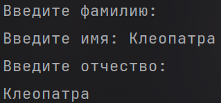

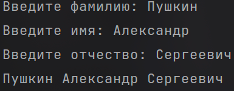

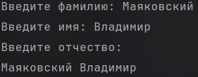

Пустой ввод:

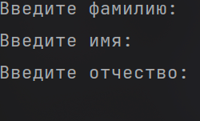

# Задание 2

## Задача 2

### Текст задачи

Человек с именем.
Объедините сущности Человек из задачи 1.2 и Имя из задачи 1.3 таким образом, чтобы имя
человека задавалось с использованием сущности 1.3, а не строки.
Необходимо объединить ранее созданные объекты имен и людей, с получением:
• Человека с Именем Клеопатра и ростом 152
• Человека с Именем Пушкин Александр Сергеевичи ростом 167
• Человека с Именем Маяковский Владимир и ростом 189

### Алгоритм решения

#### Описание класса HumanWithName

1. Объявляются два приватных поля: _name типа Name? (имя человека как объект сущности «Имя») и _height типа int? (рост). Оба могут быть не заданы (null).
2. Для _name создаётся публичное свойство Name. Сеттер просто сохраняет переданный объект.
3. Для _height создаётся публичное свойство Height. В сеттере проверяется значение:
4. если передан null, в поле записывается null;
5. если значение больше нуля, оно сохраняется;
6. иначе в поле записывается null и выводится сообщение «Не удалось присвоить рост».
7. Конструктор принимает два необязательных параметра (по умолчанию null) и присваивает их через свойства, поэтому проверка роста действует и при создании объекта.

#### Алгоритм метода ToString()

1. Строка результата начинается со слова «Человек».
2. Проверяется имя: если объект Name задан и не пуст (IsEmpty() возвращает false), к результату добавляется перевод строки и Имя: с его строковым представлением. Иначе добавляется пустая строка.
3. Проверяется рост: если он задан, добавляется перевод строки и Рост: со значением. Иначе добавляется пустая строка.
4. Склеенная строка возвращается как результат.

### Тестирование

Корректный ввод:

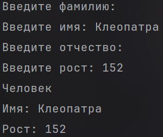

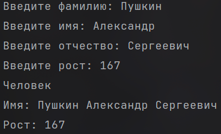

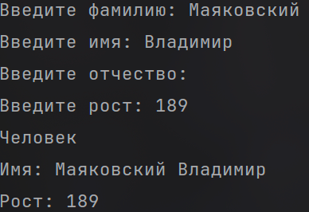

Отсутствие имени:

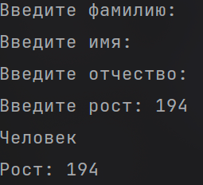

Отсутствие роста:

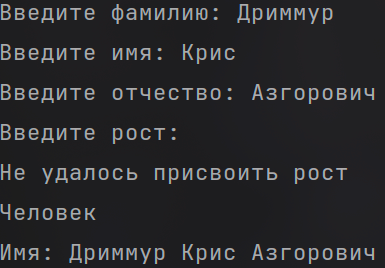

Рост не натуральное число:

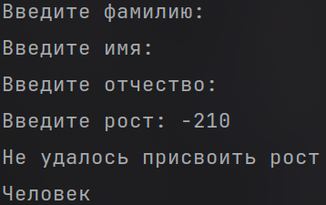

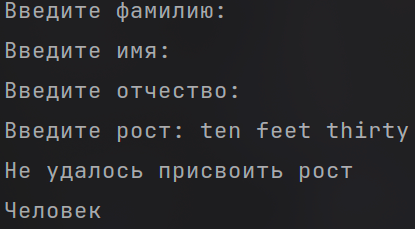

## Задача 3

### Текст задачи

Человек с родителем.
Измените сущность Человек из задачи 2.2 добавив ему возможность задавать третий параметр:
Отец, где Отец — это тоже Человек. При приведении человека к строковой форме необходимо
проверить параметры имени, и в зависимости от ситуации выполнить одно из следующих
действий:
• Если у данного человека нет фамилии, и есть отец, у которого фамилия задана, то
фамилию необходимо сделать такой же как у отца.
• Если у данного человека нет отчества, а у отца есть имя, то необходимо задать отчество
как имя отца с добавлением суффикса “ович”.
Затем необходимо выполнить следующие задачи:
1. Создать людей: Чудова Ивана, Чудова Петра, Бориса
2. Сделать Ивана отцом Петра, а Петра отцом Бориса
3. Вывести на экран строковое представление всех троих людей.
   При желании можно попытаться реализовать систему в более полном виде: предусмотреть
   разные виды суффиксов отчества в зависимости от окончания имени, а также предусмотреть
   возможность задавать пол человека и менять суффикс отчества в зависимости от пола.

### Алгоритм решения

#### Описание класса HumanWithParent

1. Класс наследуется от HumanWithName, поэтому уже содержит имя (Name) и рост (Height) вместе с их проверками.
2. Добавляется приватное поле _parent типа HumanWithParent? (отец человека, который тоже является человеком). Оно может быть не задано (null).
3. Для _parent создаётся публичное свойство Parent. В сеттере выполняются следующие действия:
   1. переданное значение сохраняется в _parent;
   2. если у человека не задана фамилия (Name?.LastName == null), то при отсутствии объекта Name создаётся пустой Name, после чего в фамилию записывается фамилия отца;
   3. если у человека не задано отчество (Name?.Patronymic == null), то при отсутствии объекта Name создаётся пустой Name, после чего в отчество записывается имя отца с добавлением суффикса «ович». Если имя отца не задано, в отчество записывается пустая строка (сеттер класса Name превращает её в null).
4. Конструктор принимает три необязательных параметра (name, height, parent; по умолчанию null), передаёт name и height в конструктор базового класса и присваивает parent через свойство Parent, поэтому проверки из шагов 5 и 6 действуют и при создании объекта.

#### Алгоритм метода ToString()

1. Берётся строка, которую возвращает ToString() базового класса (слово «Человек», имя и рост).
2. Проверяется отец: если он задан и у него есть объект Name, к результату добавляется перевод строки и Родитель: со строковым представлением имени отца. Иначе добавляется пустая строка.
3. Склеенная строка возвращается как результат.

#### Выполнение задачи (метод Task23)

1. Создаётся массив из трёх объектов HumanWithParent.
2. Для каждого из трёх людей с клавиатуры вводятся фамилия, имя, отчество и рост. На их основе создаётся объект Name, затем объект HumanWithParent (без отца) и записывается в массив.
3. Введённые люди выводятся на экран с помощью ArrayToString() класса ArrayHelper (элементы разделяются переводом строки).
4. Назначаются отцы: сначала humans[2].Parent = humans[1] (второй человек становится отцом третьего), затем humans[1].Parent = humans[0] (первый человек становится отцом второго).
5. Обновлённые люди снова выводятся на экран.

### Тестирование

# Задание 3

## Задача 2

### Текст задачи

Ломаная.
Создайте сущность Ломаная, которая будет представлять собой ломаную линию (см. пример на
рис.1). Ломаная линия представляет собой набор следующих характеристик:
• Имеет массив Точек (из задачи 1.1), через которые линия проходит.
• Может быть приведена к строковой форме вида “Линия [Т1,T2,…,TN]”, где TN – это
результат приведения к строке Точки с номером N
Необходимо выполнить следующие задачи:
• Создать первую Ломаную, проходящую через точки {1;5}, {2;8}, {5;3}
• Создайте вторую Ломаную, чья первая и последняя Точка совпадает с таковыми у первой
Ломаной, но в качестве середины имеет точки: {2,-5}, {4,-8}
• Сдвиньте начало первой Ломаной таким образом, чтобы одновременно сдвинулось
начало второй Ломаной.

### Алгоритм решения

#### Описание класса Point

1. Объявляются два приватных поля: _x и _y типа double?, то есть координата может отсутствовать (null).
2. Для каждого поля создаётся публичное свойство (X и Y) с обычными get и set.
3. Первый конструктор принимает два необязательных параметра x и y (по умолчанию null) и присваивает их через свойства.
4. Второй конструктор принимает строку с координатами и строку-разделитель. Если любая из строк равна null, выводится сообщение «Не удалось создать точку из строки», а обе координаты становятся null. Иначе строка разбивается по разделителю с помощью метода Split<double>() класса ArrayHelper. Если получить массив не удалось или в нём не ровно два числа, выводится то же сообщение, а обе координаты становятся null. Иначе первое число записывается в X, второе в Y.

#### Алгоритм метода ToString() класса Point

1. Результат начинается с «( ».
2. Если X не задан, добавляется «Неизвестно», иначе значение X.
3. Добавляется « : ».
4. Если Y не задан, добавляется «Неизвестно», иначе значение Y.
5. Добавляется « )» и строка возвращается как результат.

#### Описание класса PolygonalLine

1. Объявляются два приватных поля: _points типа Point[]? (массив точек, через которые проходит линия) и _length типа double? (длина). Оба могут быть не заданы (null).
2. Для _points создаётся публичное свойство Points с обычными get и set. Так как Point является классом, массив хранит ссылки на объекты точек.
3. Для _length создаётся публичное свойство Length. В геттере длина каждый раз пересчитывается методом GetLength() и записывается в поле, после чего возвращается.
4. Конструктор принимает один необязательный параметр points (по умолчанию null) и присваивает его через свойство Points.
5. Метод Add(point) добавляет точку в конец ломаной. Если массива точек ещё нет, создаётся пустой массив. Затем вызывается метод Insert() класса ArrayHelper с индексом -1 (отрицательный индекс отсчитывается с конца, поэтому -1 означает вставку в конец), и результат записывается обратно в Points.
6. Метод Connect(other) объединяет начало и конец двух ломаных. Если у какой-либо из ломаных нет точек, метод завершается. Иначе первой точке другой ломаной присваивается ссылка на первую точку текущей ломаной, а последней точке другой ломаной — ссылка на последнюю точку текущей. В результате у обеих ломаных первая и последняя точки являются одними и теми же объектами.

#### Алгоритм метода Insert() класса ArrayHelper

1. Создаётся новый массив на один элемент длиннее исходного.
2. Если индекс не меньше длины нового массива, выводится сообщение «Вставка на индекс превышающий длину списка запрещена» и возвращается null.
3. Если индекс отрицательный, он пересчитывается как длина нового массива плюс индекс.
4. Новый массив заполняется в цикле: элементы до индекса копируются из исходного массива, на позицию индекса ставится вставляемый элемент, остальные элементы копируются со сдвигом на один.
5. Новый массив возвращается как результат.

#### Алгоритм метода ToString() класса PolygonalLine

1. Результат начинается со слова «Ломаная: [ ».
2. Если массив точек задан, добавляются строковые представления всех точек через запятую. Иначе добавляется «Пусто».
3. Добавляется « ] », перевод строки и «Длина: » со значением длины (если длину посчитать не удалось, выводится 0).
4. Строка возвращается как результат.

#### Выполнение задачи (метод Task32)

1. Создаются две пустые ломаные l1 и l2.
2. Вводится количество точек первой ломаной, затем для каждой точки с клавиатуры вводятся координаты через пробел. Из строки создаётся Point, который добавляется в l1 методом Add(). Так же заполняется вторая ломаная l2.
3. Обе получившиеся ломаные выводятся на экран.
4. Вызывается l1.Connect(l2): начало и конец второй ломаной становятся такими же объектами, как начало и конец первой.
5. Вводятся новые координаты начала. Они записываются в X и Y первой точки ломаной l1.
6. Обе ломаные снова выводятся на экран. Так как первая точка у них общая (один и тот же объект), начало сдвигается одновременно у обеих ломаных.

### Тестирование

# Задание 4

## Задача 9

### Текст задачи

Создаем Ломаную.
Измените сущность Ломаная из задачи 1.3.2. Новые требования включают:
• Ломаная может быть создана без указания каких-либо параметров
• Ломаная может быть создана с указанием некоторого набора Точек

### Алгоритм решения

#### Описание изменений в классе PolygonalLine

1. Оба способа создания реализованы одним конструктором, который принимает необязательный параметр points типа Point[]? (по умолчанию null).
2. При создании без параметров массив точек остаётся не заданным (null). Такая ломаная при выводе показывает «Пусто» и длину 0.
3. При создании с набором точек переданный массив присваивается через свойство Points.
4. Описание остальных элементов класса (Points, Length, Add(), ToString()) приведено в задании 3, задаче 2.

#### Выполнение задачи (метод Task49)

1. Создаётся ломаная без параметров и выводится на экран.
2. Вводится количество точек. Создаётся массив точек такого размера, и для каждой точки с клавиатуры вводятся координаты через пробел, из которых создаётся Point.
3. Создаётся ломаная из заполненного массива.
4. Получившаяся ломаная выводится на экран.

### Тестирование

# Задание 5

## Задача 7

### Текст задачи

Длина Ломаной.
Измените сущность Ломаная из задачи 4.9. Новые требования включают:
• В любой момент к имеющимся Точкам можно добавить новые Точки (добавляется либо
массив, либо просто перечень Точек, что приводит к получению нового массива,
содержащего как старые, так и новые значения).
• Может возвращать общую длину Ломаной.
Необходимо выполнить следующие задачи:
1. Создать Ломаную, проходящую через точки {1;5}, {2;8}, {5;3}
2. Вывести на экран её длину
3. Добавить (к ранее созданной Ломаной) точки {5;15}, {8;10}
4. Снова вывести на экран длину Ломаной

### Алгоритм решения

#### Описание изменений в классе PolygonalLine

1. Метод Add(point) добавляет одну точку в конец ломаной (описан в задании 3, задаче 2).
2. Метод Insert(point, index) добавляет одну точку на указанную позицию. Если массива точек ещё нет, создаётся пустой массив. Для вставки вызывается метод Insert() класса ArrayHelper, результат записывается в Points.
3. Метод InsertMany(points, index) добавляет массив точек начиная с указанной позиции. Если массива точек ещё нет, создаётся пустой массив. Для вставки вызывается метод InsertMany() класса ArrayHelper, результат записывается в Points. Во всех трёх методах результатом вставки является новый массив, содержащий и старые, и новые точки.

#### Алгоритм метода InsertMany() класса ArrayHelper

1. Создаётся новый массив длиной, равной сумме длин исходного и вставляемого массивов.
2. Если индекс больше длины исходного массива, выводится сообщение «Вставка на индекс превышающий длину списка запрещена» и возвращается null.
3. Если индекс отрицательный, он пересчитывается как длина исходного массива плюс один плюс индекс.
4. Новый массив заполняется в цикле: элементы до индекса копируются из исходного массива, затем идут элементы вставляемого массива, затем оставшиеся элементы исходного массива.
5. Новый массив возвращается как результат.

#### Алгоритм вычисления длины (метод GetLength())

1. Если массива точек нет, возвращается null.
2. Длина ломаной сначала равна 0.
3. В цикле, начиная со второй точки, берутся координаты текущей и предыдущей точек.
4. Если какая-либо из четырёх координат не задана, выводится сообщение «Координата точки не указана, посчитать длину нельзя» и возвращается null.
5. К длине добавляется расстояние между двумя точками: квадратный корень из суммы квадратов разностей координат по X и по Y.
6. После окончания цикла возвращается накопленная длина.

Длина вычисляется заново при каждом обращении к свойству Length, поэтому после добавления точек она всегда актуальна. Длина выводится в строке «Длина:» метода ToString().

#### Выполнение задачи (метод Task57)

1. Создаётся пустая ломаная. Вводится количество точек, затем для каждой точки с клавиатуры вводятся координаты через пробел, и точка добавляется в ломаную методом Add().
2. Ломаная выводится на экран вместе с длиной.
3. Вводятся координаты одной точки и позиция вставки. Точка вставляется в ломаную методом Insert().
4. Ломаная снова выводится на экран вместе с новой длиной.
5. Вводится количество точек и координаты каждой из них, из которых формируется массив. Вводится позиция вставки, и массив вставляется в ломаную методом InsertMany().
6. Ломаная выводится на экран в третий раз вместе с новой длиной.

### Тестирование