# Федоров Дмитрий ЛА-3 Лабораторная №3

### Примечание: Во всех задачах на работу с файлами в проверке на корректный ввод используются фиксированые пути, они подставляются, если путь не был введён пользователем.

# Задание 1

## Задача 10

### Текст задачи

Первый массив, размерностью n х m, заполняется данными, вводимыми с клавиатуры, так что заполнение ведется по столбцам от первых элементов столбца к последним.

Второй массив, размерностью n х n, заполняется случайными числами так, что нечетные числа заносятся в элементы массива, которые на шахматной доске были бы черными, а четные числа заносятся в элементы, которые на шахматной доске были бы белыми.

Третий массив, размерностью n х n, заполняется для произвольного n так же, как для n=5:

```
25 24 20 19 11
23 21 18 12 10
22 17 13  9  4
16 14  8  5  3
15  7  6  2  1
```

### Алгоритм решения

#### Описание класса Matrix

1. Класс содержит единственное поле _values типа int[,] (двумерный массив) и публичное свойство Values.
2. Заполнение массивов реализовано тремя конструкторами. Первый конструктор принимает готовый двумерный массив и присваивает его через свойство Values. Он нужен для создания матриц внутри методов и операторов.
3. Конструкторы различаются набором параметров: Matrix(int rows, int cols) — ввод с клавиатуры, Matrix(int n, string mode) — генерация квадратной матрицы по режиму ("chess" или "pattern").

#### Алгоритм конструктора Matrix(rows, cols) 

1. Создаётся пустой массив размером rows x cols.
2. В цикле по столбцам, от первого к последнему, с клавиатуры вводится массив из чисел через пробел, количество чисел в массиве равно количеству строк, на это есть проверка.
3. Введённые числа записываются в текущий столбец сверху вниз. Таким образом заполнение ведётся по столбцам от первых элементов столбца к последним.
4. Заполненный массив присваивается в Values.

#### Алгоритм конструктора Matrix(n, "chess") 

1. Создаётся пустой массив размером n x n. Левая верхняя клетка (индексы 0, 0) считается белой, как на обычной шахматной доске, поэтому клетки с чётной суммой индексов i + j — белые, с нечётной — чёрные.
2. Для каждого элемента генерируется случайное чётное число (рандомное умножить на 2).
3. Если сумма индексов чётная, в элемент записывается само чётное число. Иначе к чётному числу прибавляется единица и записывается уже нечётное число.
4. Заполненный массив присваивается в Values.

#### Алгоритм конструктора Matrix(n, "pattern") 

Числа записываются по убыванию от n * n до 1. Обход идёт зигзагом по диагоналям, параллельным побочной, начиная с левого верхнего угла.

1. Создаётся пустой массив n x n. Начальные значения: текущая позиция row = 0, col = 0, направление обхода switcher = 1, следующее записываемое число number = n * n, признак перехода через побочную диагональ halfwayTrigger = false.
2. Пока позиция не вышла за границы массива, в текущую клетку записывается number, после чего number уменьшается на 1.
3. Если текущая клетка лежит в последнем столбце или в последней строке, halfwayTrigger становится true. Это означает, что обход перешёл ко второй половине массива, где диагонали упираются в нижнюю и правую границы.
4. Если диагональ закончилась (позиция дошла до границы массива), выполняется шаг вдоль границы на соседнюю клетку: в первой половине это шаг вправо (при row == 0) или вниз (при col == 0), во второй половине — вправо (при row == n - 1) или вниз (при col == n - 1). Направление switcher меняется на противоположное, и в клетку, в которую шагнули, записывается следующее число.
5. После этого позиция смещается вдоль диагонали: row -= switcher, col += switcher. Благодаря смене направления диагонали проходятся то снизу вверх, то сверху вниз.
6. Цикл завершается, когда позиция выходит за пределы массива (row == n или col == n). Все клетки к этому моменту заполнены.
7. Заполненный массив присваивается в Values.

#### Алгоритм метода ToString()

1. Создаётся пустая строка результата.
2. Для каждой строки массива формируется строка, в которую через символ табуляции записываются все элементы строки.
3. К результату добавляется сформированная строка и перевод строки.
4. Строка возвращается как результат, что позволяет вывести матрицу на экран в виде таблицы.

#### Выполнение задачи (метод Task110)

1. С клавиатуры вводятся число строк и число столбцов, принимаются только натуральные числа. Создаётся первая матрица Matrix(rows, cols), после чего она выводится на экран.
2. Вводится размерность n1 (натуральное число). Создаётся вторая матрица Matrix(n1, "chess") и выводится на экран.
3. Вводится размерность n2 (натуральное число). Создаётся третья матрица Matrix(n2, "pattern") и выводится на экран.

### Тестирование

Корректный ввод:

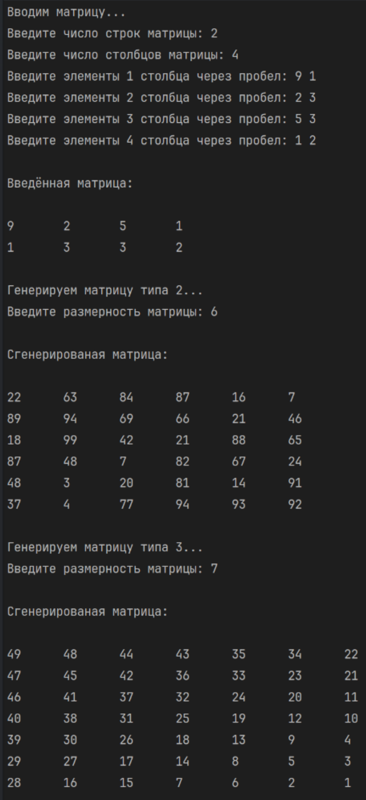

Не натуральные размеры матрицы:

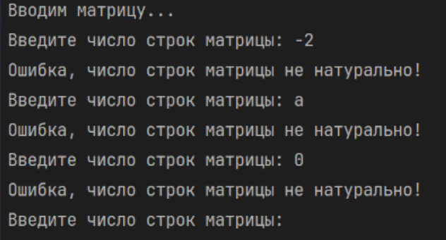

Ввод неверного количества элементов столбца:

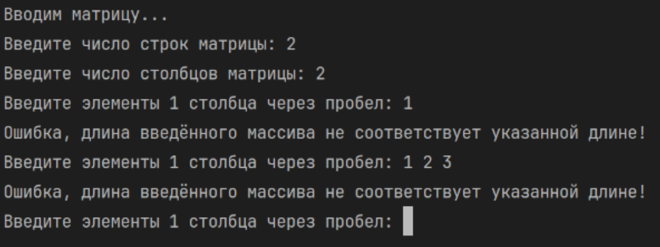

Ввод в матрицу не чисел:

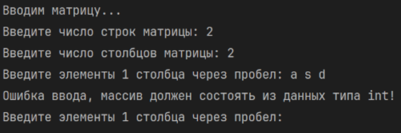

# Задание 2

## Задача 10

### Текст задачи

Определите сколько элементов двумерного массива больше любого элемента главной диагонали.

### Алгоритм решения

#### Алгоритм метода CountGreaterThenDiagonal() класса Matrix

1. Элемент больше любого элемента главной диагонали тогда и только тогда, когда он больше максимального элемента главной диагонали. Поэтому задача сводится к поиску этого максимума.
2. Определяется число строк матрицы, создаётся одномерный массив такой длины, и в него копируются элементы главной диагонали.
3. Максимум диагонали находится методом Max() класса ArrayHelper.
4. Счётчик counter устанавливается в 0. В двойном цикле просматриваются все элементы матрицы, и для каждого элемента, который строго больше максимума диагонали, счётчик увеличивается на 1.
5. Значение счётчика возвращается как результат.

#### Выполнение задачи (метод Task210)

1. С клавиатуры вводятся число строк и число столбцов (натуральные числа).
2. Главная диагональ определена только для квадратной матрицы, поэтому, если число строк не равно числу столбцов, выводится сообщение «Число строк должно быть равно числу столбцов для этой задачи!» и метод завершается.
3. Создаётся матрица Matrix(rows, cols), вводятся её элементы, матрица выводится на экран.
4. Вызывается CountGreaterThenDiagonal(), и его результат выводится на экран.

### Тестирование

Корректный ввод:

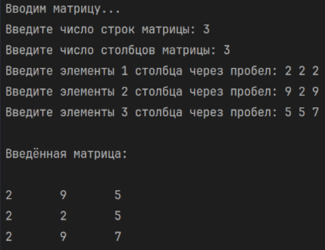

Число строк не равно числу столбцов:

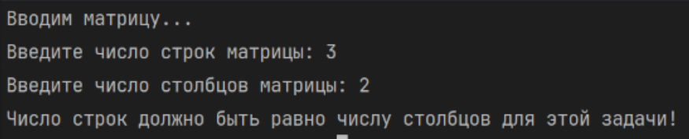

Прочие проверки на ввод описаны в Task110.

# Задание 3

## Задача 10

### Текст задачи

Работа с двумерными массивами как с матрицами. Необходимо перегрузить необходимые операторы и посчитать значение матричного выражения:


АxСт + ВxС


(где Ст — транспонированная матрица C). Приложить скриншот проверки на онлайн-калькуляторе.

### Алгоритм решения

#### Алгоритм метода Transpose()

1. Определяются число строк и столбцов матрицы, создаётся пустая матрица размером cols x rows.
2. В цикле по i от 0 до cols - 1 в строку i новой матрицы записывается столбец i исходной матрицы (методы Col() и UpdateRow()).
3. Новая матрица возвращается как результат.

#### Вспомогательные методы Row(), Col(), UpdateRow() и UpdateCol()

1. Row(index) и Col(index) копируют в новый одномерный массив строку или столбец матрицы с заданным номером.
2. UpdateRow(row, index) и UpdateCol(col, index) записывают массив в строку или столбец матрицы. Перед записью проверяется, что длина массива равна числу столбцов (для строки) или числу строк (для столбца), что индекс не больше последнего допустимого и что индекс не отрицательный. Если проверка не пройдена, выводится сообщение об ошибке и запись не выполняется.

#### Алгоритм перегруженного оператора +

1. Если любая из матриц равна null, выводится сообщение «Невозможно сложить пустые матрицы» и возвращается null.
2. Если размеры матриц не совпадают, выводится сообщение «Ошибка, размерности матриц не совпадают!» и возвращается null.
3. Создаётся результирующая матрица того же размера.
4. В цикле по строкам в строку i результата записывается сумма строк i обеих матриц, которая считается методом SumArrays() класса ArrayHelper (поэлементное сложение двух массивов).
5. Результирующая матрица возвращается как результат.

#### Алгоритм перегруженного оператора *

1. Если любая из матриц равна null, выводится сообщение «Невозможно умножить пустые матрицы» и возвращается null.
2. Если число столбцов первой матрицы не равно числу строк второй, выводится сообщение «Ошибка, столбцы первой матрицы не совпадают со строками второй!» и возвращается null.
3. Создаётся результирующая матрица размером (число строк первой) x (число столбцов второй). Вторая матрица транспонируется, чтобы её столбцы можно было получать как строки.
4. Элемент результата [i, j] равен скалярному произведению строки i первой матрицы и строки j транспонированной второй матрицы. Произведение элементов массивов считается методом MultiplyArrays(), а сумма — методом Sum() класса ArrayHelper.
5. Результирующая матрица возвращается как результат.

Оператор * перегружен для двух матриц, поэтому выражение вычисляется в том виде, в котором записано в условии, а приоритет операций (умножение выполняется раньше сложения) обеспечивает сам язык.

#### Выполнение задачи (метод Task310)

1. Последовательно вводятся матрицы A, B и C: для каждой с клавиатуры вводятся число строк и столбцов (натуральные числа) и элементы по столбцам. Каждая введённая матрица выводится на экран.
2. Вычисляется выражение A * C.Transpose() + B * C. Результат выводится на экран. Если размеры матриц не позволяют вычислить выражение, оператор выводит сообщение об ошибке и возвращает null.

### Тестирование

Корректный ввод + скриншот проверки на онлайн-калькуляторе:

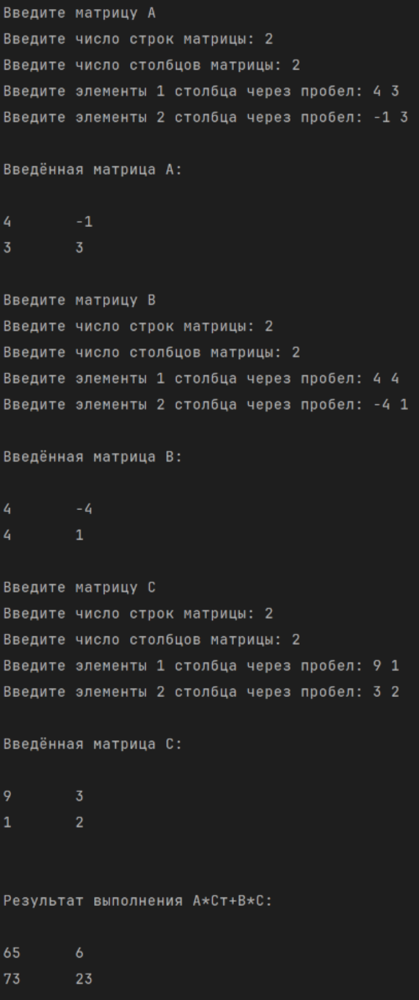

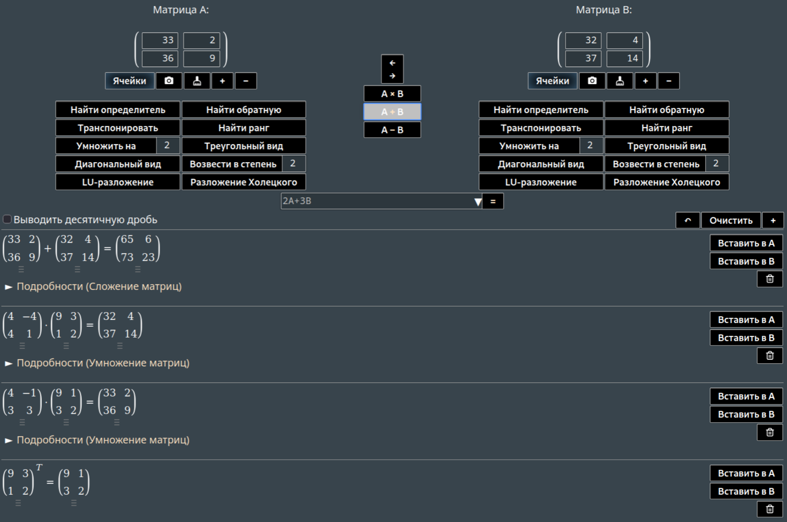

Несовпадающие размеры матриц:

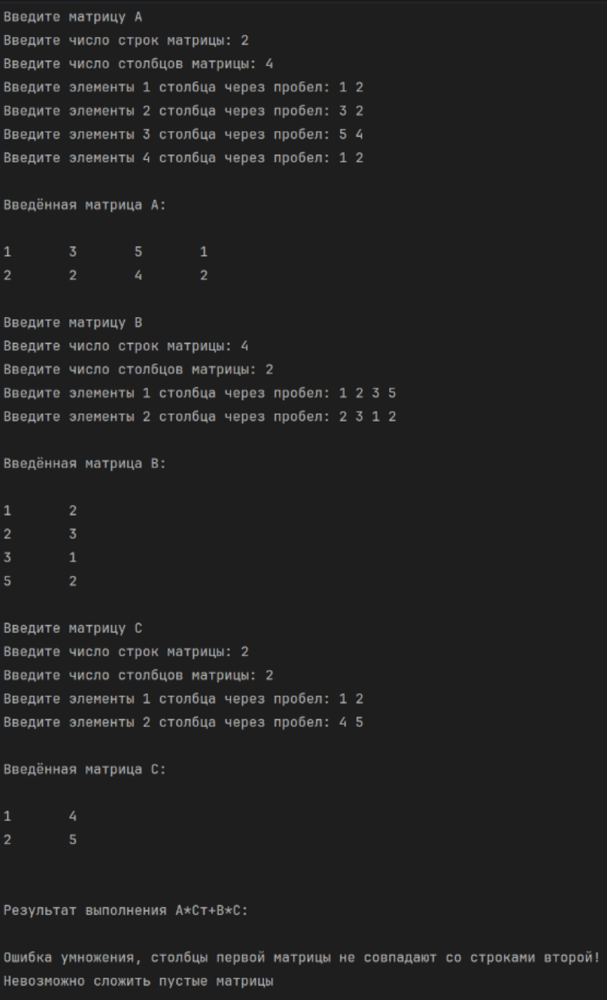

Прочие проверки на ввод описаны в Task110.

# Задание 4

## Задача 10

### Текст задачи

Найти количество удвоенных нечетных чисел среди компонент файла.

### Алгоритм решения

#### Алгоритм метода GenerateIntBin() класса FileManager

1. Размер файла задаётся в байтах. Так как каждое число типа int занимает 4 байта, количество чисел равно size / 4.
2. Создаётся массив такой длины, и каждый элемент заполняется случайным неотрицательным числом rng.Next().
3. Массив возвращается как результат.

#### Алгоритм метода GenerateBinFile<Т>() класса FileManager

1. Метод принимает размер файла и путь к файлу. Он вызывает генератор для соответствующего типа и получает массив элементов.
2. Файл открывается в режиме FileMode.Create через BinaryWriter.
3. Для каждого элемента, в зависимости от типа, выполняется запись: числа int записываются методом writer.Write(i).
4. Ошибки доступа к файлу, отсутствия папки и ввода-вывода перехватываются и выводятся сообщением на экран.

#### Алгоритм метода ReadBinFile<Т>() класса FileManager

1. Файл открывается через BinaryReader.
2. Для типа int: пока позиция в потоке меньше его длины, читается очередное число методом ReadInt32() и добавляется в список.
3. Список преобразуется в массив и возвращается. При ошибке доступа к файлу возвращается null.

#### Выполнение задачи (метод Task410)

1. Бинарный файл integers.bin размером 1 МБ (1024 * 1024 байт) заполняется случайными числами методом GenerateBinFile(), генератором GenerateIntBin().
2. Числа считываются из файла методом ReadBinFile<int>(). Если чтение не удалось, программа сообщает об ошибке.
3. Удвоенное нечётное число имеет вид 2 * (2k + 1) = 4k + 2, то есть при делении на 4 даёт остаток 2. Поэтому в цикле по числам проверяется условие number % 4 == 2, и для подходящих чисел счётчик увеличивается на 1.
4. Значение счётчика выводится на экран.

### Тестирование

Корректный ввод:

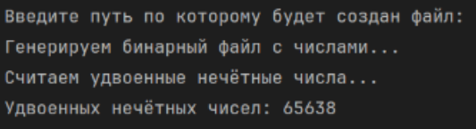

Неправильный путь к файлу:

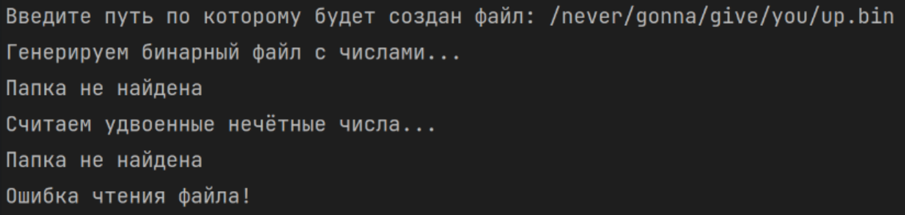

# Задание 5

## Задача 10

### Текст задачи

Файл содержит сведения об игрушках: название игрушки, ее стоимость в рублях и возрастные границы (например, игрушка может предназначаться для детей от двух до пяти лет). Получить название самой дешевой игрушки.

### Алгоритм решения

#### Описание структуры Toy

1. Игрушка описывается структурой Toy с четырьмя приватными полями: _name (название), _price (цена в рублях), _minAge и _maxAge (возрастные границы). Для каждого поля создано публичное свойство с обычными get и set.
2. Конструктор без параметров заполняет игрушку случайными данными: название выбирается из списка из 30 названий, цена — случайное число от 100 до 4999, нижняя граница возраста — от 0 до 17, верхняя — от нижней границы до 18.
3. Метод ToString() возвращает строку вида «Игрушка», «Название: …», «Цена: …», «Для детей от … до … лет», разделённую переводами строки.

#### Алгоритм метода GenerateToy() класса FileManager

1. Создаётся XmlSerializer для типа Toy и пустой список игрушек. 
2. Пока число записанных байт меньше указанного размера, создаётся новая случайная игрушка, сериализуется в MemoryStream, к числу записанных байт прибавляется 4 + длина сериализованных данных (4 байта занимает запись длины, см. ниже), игрушка добавляется в список.
3. Список преобразуется в массив и возвращается.

#### Запись игрушек в бинарный файл (метод GenerateBinFile<Т>())

1. Создаётся XmlSerializer для типа Toy.
2. Каждая игрушка сериализуется в XML в MemoryStream, затем в файл записываются длина данных (4 байта, int) и сами байты. Длина нужна, так как XML-представления игрушек имеют разный размер, и без неё нельзя понять, где заканчивается одна запись и начинается другая.
3. Ошибки доступа к файлу, отсутствия папки и ввода-вывода перехватываются и выводятся сообщением на экран.

#### Чтение игрушек из бинарного файла (метод ReadBinFile<Т>())

1. Создаётся XmlSerializer для типа Toy.
2. Пока позиция в потоке меньше его длины: читается длина записи (ReadInt32()), затем столько же байт (ReadBytes()). Из этих байт создаётся MemoryStream, и игрушка десериализуется методом Deserialize(). Игрушка добавляется в список.
3. Список преобразуется в массив и возвращается. При ошибке доступа к файлу возвращается null.

#### Выполнение задачи (метод Task510)

1. Бинарный файл toys.bin размером 1 МБ заполняется игрушками методом GenerateBinFile(), генератором GenerateToy().
2. Игрушки считываются из файла методом ReadBinFile<Toy>(). Если чтение не удалось, программа сообщает об ошибке.
3. Минимальной ценой считается цена первой игрушки, индекс минимума равен 0. В цикле по всем игрушкам: если цена текущей игрушки меньше минимальной, обновляются минимальная цена и индекс.
4. На экран выводится игрушка с найденным индексом.

### Тестирование

Корректный ввод:

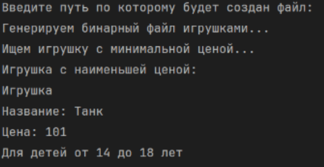

Неправильный путь к файлу:

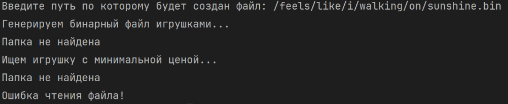

# Задание 6

## Задача 10

### Текст задачи

В файле найти квадрат разности максимального и минимального элементов.

### Алгоритм решения

#### Алгоритм метода GenerateIntText() класса FileManager

1. Создаётся пустой список чисел.
2. Пока число записанных байт меньше указанного размера, генерируется случайное неотрицательное число rng.Next(), оно добавляется в список, а к счётчику прибавляется длина его записи в виде строки плюс длина символа перевода строки (Environment.NewLine.Length). Так размер будущего файла получается близким к заданному.
3. Список преобразуется в массив и возвращается.

#### Алгоритм метода GenerateTextFile<Т>() класса FileManager

1. Метод вызывает функцию-генератор и получает массив элементов.
2. Файл открывается в режиме FileMode.Create через StreamWriter.
3. Каждое число записывается методом WriteLine(), то есть по одному числу в строке.
4. Ошибки доступа к файлу, отсутствия папки и ввода-вывода перехватываются и выводятся сообщением на экран.

#### Алгоритм метода ReadTextFile<Т>() класса FileManager

1. Файл открывается через StreamReader.
2. Cтроки читаются до конца файла, каждая преобразуется в число методом int.Parse() и добавляется в список.
3. Список преобразуется в массив и возвращается. При ошибке доступа к файлу возвращается null.

#### Выполнение задачи (метод Task610)

1. Текстовый файл integers.txt размером 1 МБ заполняется числами методом GenerateTextFile(), генератором GenerateIntText().
2. Числа считываются методом ReadTextFile<int>(). Если чтение не удалось, программа сообщает об ошибке.
3. Методы Min() и Max() класса ArrayHelper находят минимальный и максимальный элементы.
4. Вычисляется квадрат разности Math.Pow(max - min, 2), результат выводится на экран.

### Тестирование

Корректный ввод:

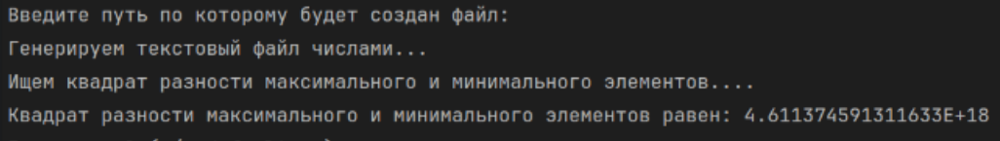

Неправильный путь к файлу:

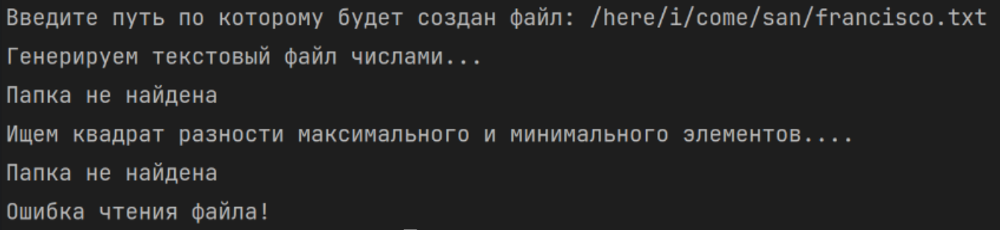

# Задание 7

## Задача 10

### Текст задачи

Решить задачу с использованием структуры «текстовый файл». Вычислить сумму нечётных элементов.

### Алгоритм решения

#### Запись и чтение чисел в одну строку (параметр inlineInt)

1. Методы GenerateTextFile() и ReadTextFile() имеют необязательный параметр inlineInt (по умолчанию false).
2. Если inlineInt = true, при записи каждое число записывается методом Write() с пробелом после него, без перевода строки. В результате все числа оказываются в одной строке через пробел.
3. При чтении в этом режиме считывается единственная строка файла, и она разбивается по пробелу методом Split<int>() класса ArrayHelper на массив чисел.
4. Числа генерируются тем же методом GenerateIntText(), что и в задании 6. Так как символ перевода строки и пробел весят одинаково, менять метод генерации не имеет смысла.

#### Выполнение задачи (метод Task710)

1. Текстовый файл inlineIntegers.txt размером 1 МБ заполняется числами через пробел (inlineInt = true).
2. Числа считываются методом ReadTextFile<int>() с inlineInt = true. Если чтение не удалось, программа сообщает об ошибке.
3. Сумма хранится в переменной типа long, чтобы не произошло переполнения (чисел очень много, и каждое может быть порядка 2 * 10^9).
4. В цикле по всем числам, если число нечётное (number % 2 == 1), оно добавляется к сумме. Числа неотрицательны, поэтому остаток от деления на 2 у нечётных равен 1.
5. Сумма выводится на экран.

### Тестирование

Корректный ввод:

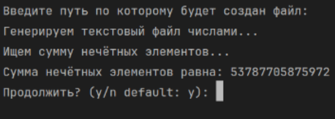

Неправильный путь к файлу:

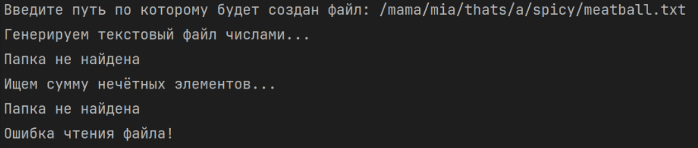

# Задание 8

## Задача 10

### Текст задачи

Создать новый текстовый файл, каждая строка которого содержит последний символ соответствующей строки исходного файла.

### Алгоритм решения

#### Алгоритм метода GenerateString() класса FileManager

1. В качестве источника текста используется файл warandpeace.txt (роман «Война и мир»). Из него выбирается фрагмент определённого размера в байтах.
2. Если требуемый размер size больше размера файла, выводится сообщение «Генерация файла такого размера не поддерживается!» и возвращается null.
3. Случайно выбирается позиция начала фрагмента от 0 до размера файла - size, чтобы фрагмент целиком помещался в файле.
4. Файл открывается через BinaryReader, выполняется переход на выбранную позицию (Seek()), считывается size байт, и они преобразуются в строку в кодировке UTF-8.
5. Строка возвращается в виде массива из одного элемента. При записи этого элемента методом WriteLine() символы перевода строки внутри фрагмента сохраняются, поэтому в исходном файле оказывается много строк.

#### Алгоритм метода WriteTextFile<Т>() класса FileManager

1. Метод принимает массив и путь к файлу. Файл открывается в режиме FileMode.Create через StreamWriter.
2. Каждый элемент массива записывается методом WriteLine(). Для null записывается пустая строка.

#### Выполнение задачи (метод Task810)

1. Текстовый файл strings.txt размером 1 МБ заполняется фрагментом текста методом GenerateTextFile(), генератором GenerateString().
2. Файл считывается построчно методом ReadTextFile<string>(). Если чтение не удалось, программа сообщает об ошибке.
3. Создаётся массив lastChars такой же длины, как массив строк. Для каждой строки, если она не пустая, в соответствующий элемент записывается её последний символ (text[i][^1]), иначе — пустая строка. Так номера строк в новом файле соответствуют номерам строк в исходном.
4. Массив lastChars записывается в файл chars.txt методом WriteTextFile(): каждый последний символ в отдельной строке.
5. Для проверки на экран выводятся первые 10 строк исходного файла и первые 10 строк нового файла (последний был считан заново методом ReadTextFile<string>()), чтобы можно было сверить символы.

### Тестирование

Корректный ввод:

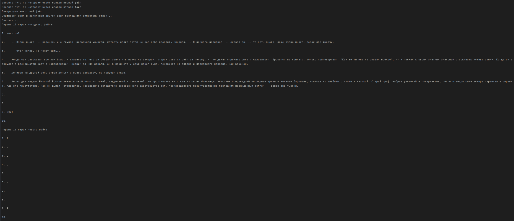

Неправильный путь к файлу:

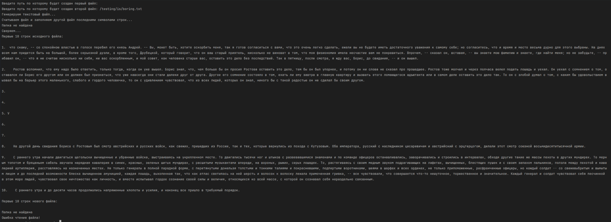

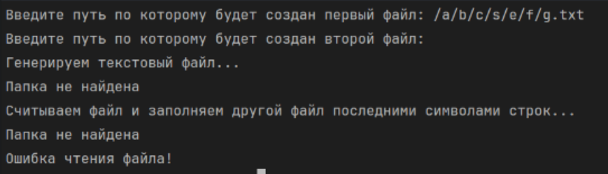
